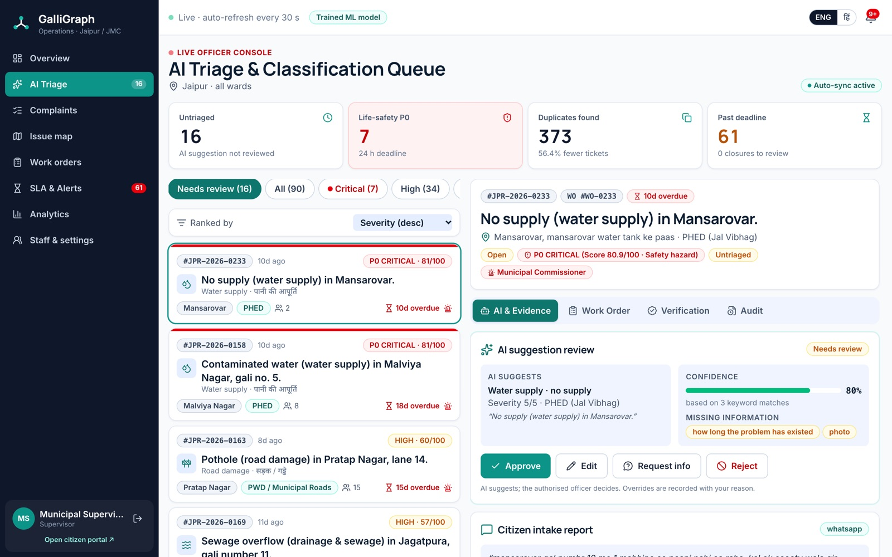
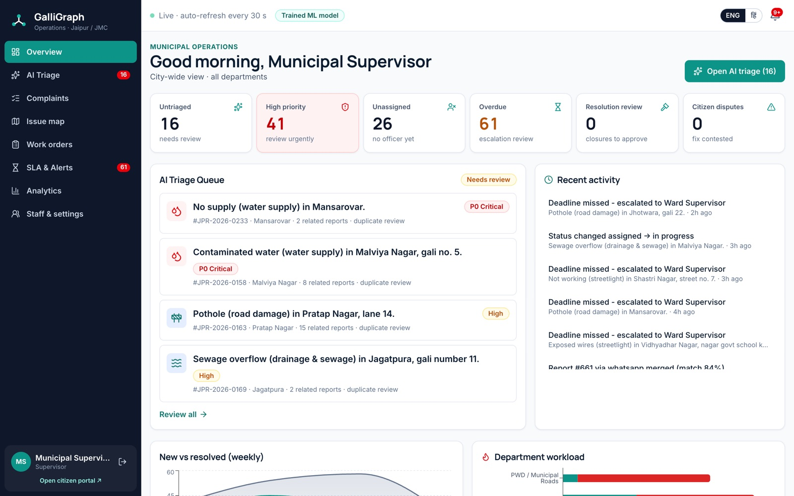
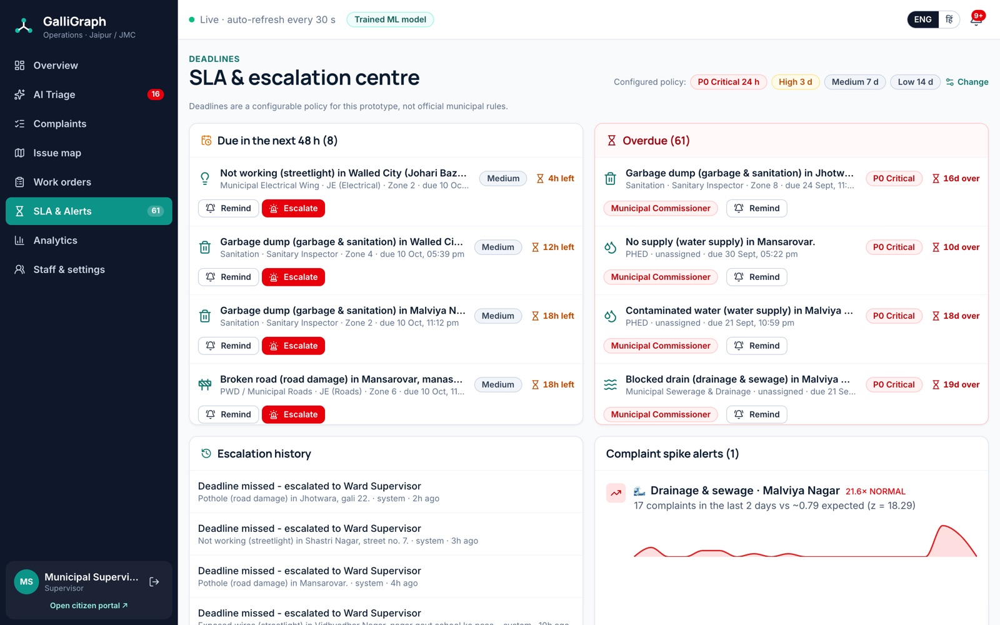
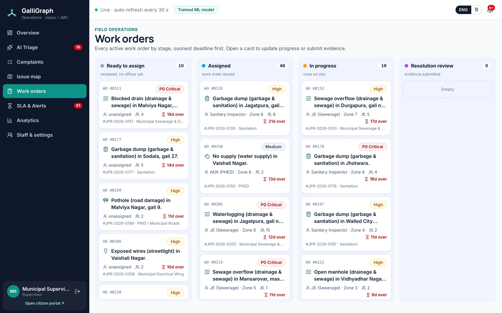
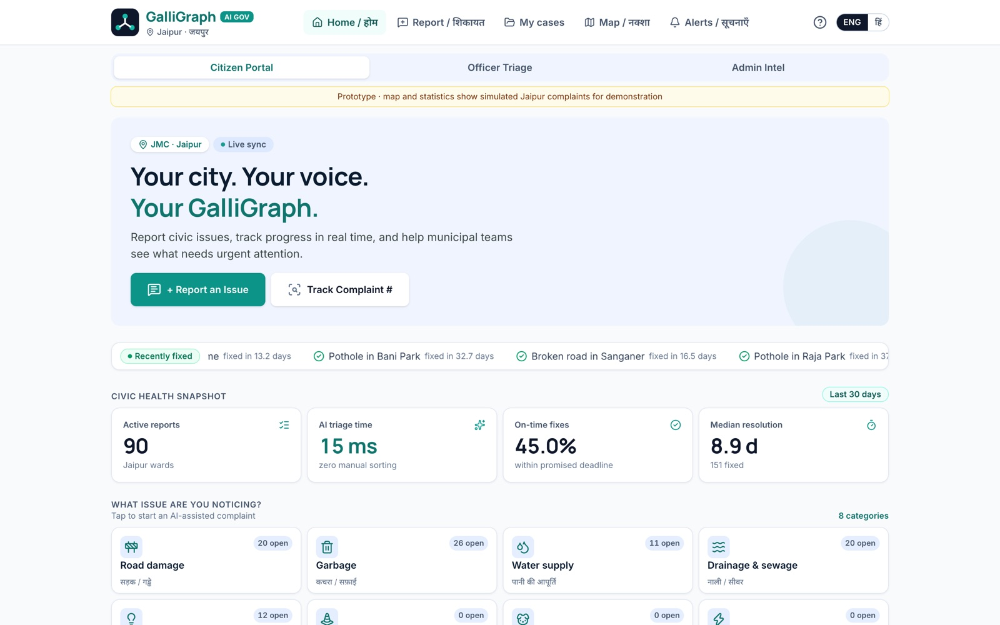
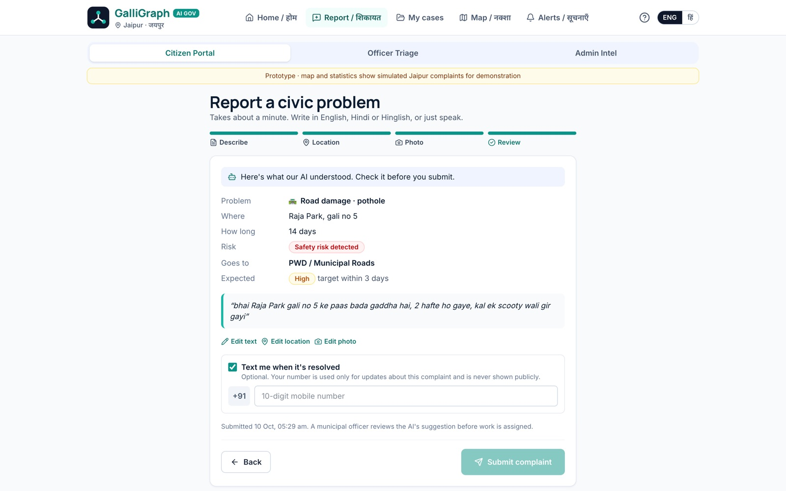
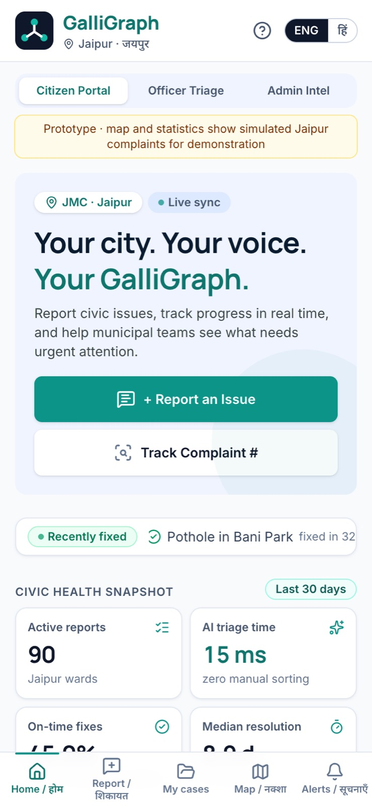
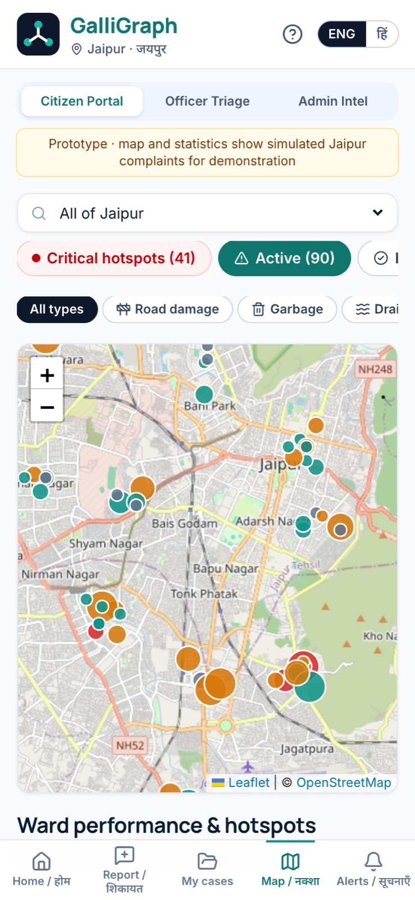
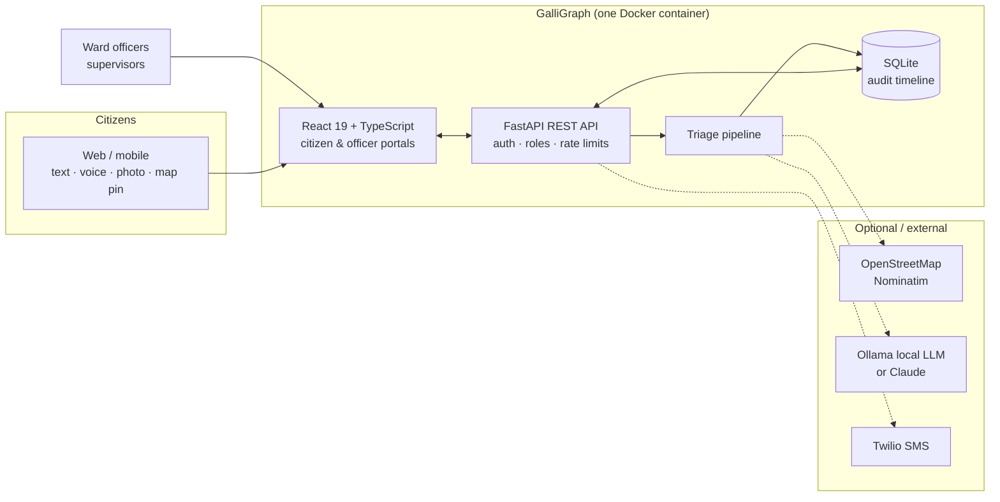
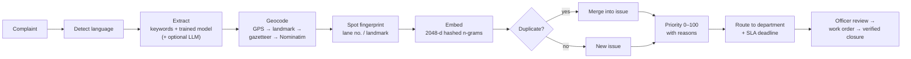

<div align="center">

# GalliGraph

### AI triage for civic complaints: messy citizen reports in, one ranked, de-duplicated, verified action list out

**Hindi-first · voice-first · explainable · human-in-the-loop · runs offline**

[](https://galligraph.onrender.com)
[](https://galligraph.onrender.com/official)


Built by **Team Codestorm** (Tanishq Tiwari & Nehal Shah) for **OFFGRID** (MUJ · IEEE SB · TechIdeate),
Problem Statement **#10 AI Civic Complaint Triage**. It also covers **#2** priority, **#4** waste, **#9** trends and **#11** duplicates.

</div>

---

> *"bhai raja park gali no 5 ke paas bada gaddha hai, 2 hafte ho gaye, kal ek scooty wali gir gayi"*
>
> ↓ **~15 ms** later ↓
>
> **Road damage · pothole** · Raja Park, gali 5 · open **14 days** · ⚠ **safety risk** · checked against open issues nearby ·
> explainable priority score · routed to **PWD** · deadline set · escalates to the Ward Supervisor if missed

## Contents

- [Why](#why) · [Results](#measured-results) · [Screenshots](#screenshots) · [Architecture](#architecture)
- [How the AI works](#how-the-ai-works) · [WhatsApp & voice](#whatsapp--voice-notes) · [Two portals](#two-portals-one-record) · [Security & privacy](#security--privacy)
- [Quick start](#quick-start) · [Configuration](#configuration) · [Deploy](#deploy) · [Project layout](#project-layout) · [Roadmap](#roadmap)

## Why

Indian cities receive complaints through apps, websites and WhatsApp as free text. Someone has to read each one and decide
*what* it is, *where*, *how bad*, and *who* fixes it. On real data we found:

- **8.4%** of 4,000 real complaints repeated an issue that was already open, so officers triage the same pothole again and again.
- Citizens choose from **231 sub-categories** and often choose wrong; keyword rules got only **69.6%** right.
- Issues get marked "closed" with **no proof**, and citizens have no way to contest it.

GalliGraph reads every complaint the way an experienced ward officer would, then gives officers a ranked, explainable,
de-duplicated queue, and closes the loop only with evidence the citizen can verify.

> **Principle: AI suggests, the authorised officer decides.** Every override is audited, and no issue is ever closed by AI alone.

## Measured results

Measured, not claimed. Every number is reproducible with the scripts in [`scripts/`](scripts).

| Metric | Result | How it was measured |
|---|---|---|
| Category accuracy on **real** complaints | **78–81%** | 1,548 unseen 2022 Bengaluru complaints; trained on 2019–21 (time split) |
| Gain from training on real data | **+11 pts** | trained model 80.6% vs keyword rules 69.6% |
| Hindi / Hinglish accuracy | **97%** | multilingual synthetic set with typos and vague landmarks |
| Duplicate-merge precision | **96.4%** | F1 0.903 (dataset A), 0.866 (held-out dataset B) |
| Real duplicates found | **8.4%** | 4,000 real complaints replayed with real GPS + timestamps |
| Ticket reduction | **56%** | 665 complaints → 292 real issues in the demo city |
| Spike detection | **19.8×** | planted drainage surge flagged within 2 days |
| Triage latency | **~15 ms** | per complaint on a laptop CPU, no GPU, no paid API |

<details>
<summary><b>Real-data accuracy breakdown</b></summary>

| Approach | Accuracy on real 2022 complaints |
|---|---|
| Always guess the most common category | 18.3% |
| Keyword rules only | 69.6% |
| **Trained model alone** (TF-IDF + logistic regression) | **80.6%** (87.9% on the 77% where it is confident) |
| **GalliGraph (model + multilingual rules)** | **78.0%** |

The combined system gives up ~3 points on English to keep Hindi/Hinglish accurate: the model never saw Hinglish, so it only
overrides the keyword rules there when it is very sure. Citizen-chosen labels are sometimes wrong (an overflowing drain filed
as "garbage"), which caps the achievable score. The real data also reshaped the product: ~13% of complaints were stray animals,
traffic or electricity, which became categories with their own routing.

</details>

<details>
<summary><b>Synthetic multilingual benchmark</b></summary>

| Metric | Dataset A (661) | Held-out dataset B (788) |
|---|---|---|
| Category accuracy | **97.0%** | **96.7%** |
| Duplicate precision | **96.4%** | |
| Duplicate recall | 84.9% | |
| Duplicate F1 | **0.903** | **0.866** |
| Planted spike detected | ✅ | ✅ |

High precision is deliberate: wrongly merging two different problems hides one of them, which is worse than leaving a duplicate unmerged.

</details>

## Screenshots

| Officer: AI triage queue | Officer: overview |
|---|---|
|  |  |
| **Officer: SLA & escalations** | **Officer: work orders** |
|  |  |
| **Citizen: home** | **Citizen: "here's what our AI understood"** |
|  |  |

<p align="center">
  
  &nbsp;&nbsp;
  
</p>

Light and dark themes, English / हिंदी toggle, mobile-first layout with bottom navigation.

## Architecture



### The pipeline (per complaint)



Every AI component has a deterministic fallback, so the system **keeps working offline** and the demo never breaks.

## How the AI works

<details open>
<summary><b>1. Classification: trained model + multilingual keyword engine</b></summary>

- **Model:** scikit-learn `Pipeline` → `FeatureUnion` of two TF-IDF vectorisers
  (word 1–2-grams, `min_df=2`; `char_wb` 3–5-grams, `min_df=3`; both `sublinear_tf`) →
  `LogisticRegression(C=4.0, class_weight="balanced")`. A second model predicts the sub-type. ~11 MB, CPU-only.
- **Leakage-free evaluation:** trained on 2019–21, tested on 2022, so the model never sees the future.
- **Keyword engine:** typo-tolerant phrase matching for English, Hindi and Hinglish (`gaddha`, `nali`, `kachra`, …) using
  `SequenceMatcher` ratios (≥0.80 for short words, ≥0.75 for long, ≥0.85 for split words like "pot hole"). Words under 5
  letters must match exactly, so "park" never matches "parked".
- **Combining them**, with language-aware thresholds (Devanagari → Hindi, Hindi words in Latin script → Hinglish):

  | | trust model when p ≥ | fallback when no keywords |
  |---|---|---|
  | English | 0.50 | 0.25 |
  | Hindi / Hinglish | 0.80 | 0.50 |

  If ≥2 keywords match, the model needs p ≥ 0.75 to override. A model "other" never beats a specific keyword.
- **LLM guardrail:** when an LLM is used, rules can only make it *safer*: it can't lower severity or drop a safety flag the
  keywords found, and an invented duration is discarded.

</details>

<details>
<summary><b>2. Duplicate detection</b></summary>

Candidates: same category, still open, reported within the last **14 days**. Then

```
score = 0.5 · text_similarity + 0.3 · geo_similarity + 0.2 · time_similarity
score ≥ 0.72  → merge
0.60 – 0.72   → merge and flag for human review
```

- **Text:** cosine similarity of a dependency-free embedding: words, word bigrams and character 3/4-grams
  (Devanagari preserved), feature-hashed (CRC32, ± sign) into 2,048 dims, `sign·log1p` scaled, L2-normalised.
  `sentence-transformers` is used automatically if installed.
- **Geo:** both locations precise → reject beyond **300 m**, else `1 − d/300` (haversine). Locality-only → 0.6 within the same locality.
- **Spot fingerprint:** lane numbers (`gali no. 5` → `n:5`) and landmarks (`lm:temple`). If both complaints have keys and share
  none, they're different places (unless GPS puts them within 100 m), so "gali 5" and "gali 12" never merge.
- **Issue centroid:** running mean of member embeddings, re-normalised.
- Officers see match %, distance and time gap side by side, and can split any merge.

</details>

<details>
<summary><b>3. Explainable priority and SLA</b></summary>

| Factor | Weight | Value (0–1) |
|---|---|---|
| Severity | 30 | (severity − 1) / 4 |
| Population impact | 20 | locality density, boosted by schools/hospitals within 300 m (873 from OSM) |
| Reports | 15 | log(1 + n + 0.5·confirmations) / log(16), so diminishing returns and no spam advantage |
| Duration | 15 | days open / 30 |
| Recurrence | 10 | same-type issues within 300 m in 90 days / 3 |
| Safety | 10 | 1 if injury / disease / electrocution risk |

Every score ships with its breakdown. Nearby-school boosts apply only to GPS/landmark locations, so there's no fake urgency.

**SLA tiers** (configurable by supervisors): ≥70 critical **24 h** · ≥50 high **72 h** · ≥30 medium **7 d** · else low **14 d**.
A missed deadline escalates to the **Ward Supervisor**; another full window escalates to the **Municipal Commissioner**. Every step is on the timeline.

</details>

<details>
<summary><b>4. Spike detection</b></summary>

Per (locality, category): recent **2 days** vs the previous **28-day** baseline, Poisson z-score:

```
expected = baseline / 28 × 2
z = (observed − expected) / √max(expected, 0.5)
alert if z ≥ 3 and observed ≥ 4 · critical if z ≥ 6
```

</details>

<details>
<summary><b>5. Verified closure</b></summary>

Officer uploads an after-repair photo → AI (Ollama vision or Claude) compares it with the citizens' photos →
**supervisor approves** → citizen confirms or disputes (a dispute triggers supervisor review) → opted-in citizens get an SMS.
Missing, unclear or mismatched evidence goes to a human. A local model only auto-accepts at *high* confidence.

</details>

## WhatsApp & voice notes

Most citizens won't open a website, but they already use WhatsApp, and many prefer to speak rather than type.

**WhatsApp bot (Twilio).** Citizens message the city's WhatsApp number with text, a 🎤 voice note, a 📷 photo and/or a 📍 shared location:

```
Citizen: bada gaddha hai 2 hafte se, scooty wale gir rahe hain
Bot:     📍 Where is this? Send the area and a landmark, or share your location.
Citizen: Raja Park gali no 5
Bot:     ✅ Complaint registered / शिकायत दर्ज हो गई
         Tracking code: JA-GZ3B-U64W · Pothole in Raja Park, gali no 5 · Goes to: PWD
         ⚠️ Safety risk noted for the officer · Target: fix within 7 days
Citizen: JA-GZ3B-U64W
Bot:     📋 Status: Assigned · Department: PWD · Target date: 02 Nov, 03:19 PM IST
```

- Same pipeline as the web form (extraction, dedup, priority, SLA). The bot asks once for anything missing (place or description).
- Sending a tracking code returns the live status; `CANCEL` starts over; greetings return a bilingual help message.
- Every webhook call is verified with Twilio's `X-Twilio-Signature` (HMAC-SHA1); forged calls get 403. Limit: 5 complaints per number per hour.
- When the issue is resolved, WhatsApp reporters are told on WhatsApp (in production, messages outside the 24 h window need an approved template).
- Setup: set `TWILIO_ACCOUNT_SID`, `TWILIO_AUTH_TOKEN`, `TWILIO_WHATSAPP_FROM`, then point the sender's "when a message comes in" webhook to `POST https://<app>/api/whatsapp/webhook`.

**Voice notes (Whisper).** On the web form, *Record voice note* works in every modern browser (unlike live dictation),
and WhatsApp voice notes go through the same engine:

- Local, free and offline with `faster-whisper` (`pip install -r backend/requirements-voice.txt`, model `small`, ~1–4 s per note), or any
  OpenAI-compatible Whisper API (e.g. a free Groq key) on small servers.
- Hindi speech is kept as spoken **plus an English translation**, which is what the classifier reads best. Example:
  *"राजा पार्क गली नंबर पांच में मैनहोल खुला पड़ा है, कल एक स्कूटी वाला गिर गया"* → open manhole · severity 5 · safety risk · Raja Park · 24 h.
- Audio is transcribed and discarded; only the text is stored.

## Two portals, one record

| | Citizen portal (`/`) | Officer portal (`/official`) |
|---|---|---|
| Who | Anyone, no account (private `JA-XXXX-XXXX` tracking code) | Municipal staff, login, role-based |
| Report | 4-step wizard: describe (**voice-to-text**) → location (**map pin**/GPS) → photo → **review what the AI understood** | – |
| Track | Stages that actually happened + public updates + after-repair photo + SMS opt-in | Full audit trail, search by tracking code |
| AI | Sees routing and priority reasons | **Approve / Edit (with reason) / Reject / Request info / Escalate**, with confidence and missing info |
| Duplicates | "I have this too (+1)" | Side-by-side merge review; confirm or split |
| Closure | **Confirm or dispute** the fix | Resolution review; AI flags, supervisor decides |
| Map | Public heat map (~100 m precision), hotspots | Operational map, spike alerts, GIS CSV export |
| Also | Notifications, FAQ, privacy settings, EN/हिं, dark mode | Work-order board, SLA centre, analytics, staff management, department scoping |

**Roles:** an *official* is scoped to their department. A *supervisor* sees the whole city, approves closures, manages staff
and configures deadline policy.

## Security & privacy

- **Passwords:** `hashlib.scrypt` (N=2¹⁴, r=8, p=1, per-user salt), constant-time comparison.
- **Sessions:** HMAC-SHA256-signed httpOnly cookies (Secure behind HTTPS); tampered cookies are rejected.
- **Rate limits:** sliding window per IP: logins 8 / 5 min, complaints 10 / 10 min → HTTP 429.
- **SQL:** user values always go through parameterised queries.
- **Privacy:** no citizen accounts; public coordinates rounded to ~100 m; citizen text, photos, officer names and internal notes
  are never public; officers see masked phone numbers; evidence photos are served only to logged-in officials.
- **Secrets:** admin password and keys come from environment variables, never from code.

## Quick start

```bash
git clone https://github.com/Tanishqtiwari1/GalliGraph.git
cd GalliGraph
./run.sh
```

Open **http://localhost:5173** (citizens), **http://localhost:5173/official** (officers) and **http://localhost:8000/docs** (API).
On first run, `run.sh` creates the virtualenv, installs packages, generates the synthetic dataset and seeds the database.

<details>
<summary><b>Manual setup and scripts</b></summary>

```bash
cd backend
python3 -m venv .venv && .venv/bin/pip install -r requirements.txt
cp .env.example .env                                   # set CIVICPULSE_ADMIN_PASSWORD
.venv/bin/python ../scripts/generate_synthetic.py      # data/synthetic_complaints.csv
.venv/bin/python ../scripts/seed.py                    # load into civicpulse.db
.venv/bin/uvicorn app.main:app --reload --port 8000

cd ../frontend && npm install && npm run dev
```

```bash
.venv/bin/python ../scripts/evaluate.py                                      # synthetic accuracy / dedup metrics
.venv/bin/python ../scripts/evaluate_real.py                                 # real-data accuracy + duplicate study
.venv/bin/python ../scripts/train_classifier.py --csv path/to/complaints.csv # retrain (~3 min)
.venv/bin/python ../scripts/fetch_pois.py                                    # refresh schools & hospitals from OSM
.venv/bin/python ../scripts/create_user.py <username> --role official --name "JE (Roads) Zone 3"
```

The deployed model (`backend/models/complaint_classifier.joblib`) is committed; the raw third-party dataset is not.

</details>

## Configuration

All settings are environment variables (see `backend/.env.example`).

| Variable | Default | Purpose |
|---|---|---|
| `CIVICPULSE_EXTRACTOR` | `rules` | `rules` (trained model + keywords, free, ms), `ollama` (free local LLM), `claude` / `auto` |
| `CIVICPULSE_VERIFIER` | `auto` | after-repair photo checker: `auto` / `claude` / `ollama` / `none` |
| `CIVICPULSE_ADMIN_USER` / `_PASSWORD` | `admin` / – | first supervisor account |
| `CIVICPULSE_SECRET_KEY` | – | session signing key |
| `CIVICPULSE_SMS_PROVIDER` | `console` | `console` (logged, not sent) or `twilio` (+ `TWILIO_*`) |
| `DEDUP_RADIUS_M` · `DEDUP_WINDOW_DAYS` | 300 · 14 | duplicate search radius and window |
| `DEDUP_MERGE_THRESHOLD` · `DEDUP_REVIEW_THRESHOLD` | 0.72 · 0.60 | merge cut-offs |
| `SPIKE_RECENT_DAYS` · `SPIKE_BASELINE_DAYS` · `SPIKE_Z_THRESHOLD` | 2 · 28 · 3.0 | spike detector |
| `CIVICPULSE_OLLAMA_TEXT_MODEL` · `_VISION_MODEL` | qwen2.5:7b · gemma3:4b | local models |

A good free setup: `CIVICPULSE_EXTRACTOR=rules` + `CIVICPULSE_VERIFIER=ollama`. The trained model reads complaints in
milliseconds and a local model checks photos, so **complaints never leave the server**.

## Deploy

One container: a multi-stage `Dockerfile` builds the React app, and FastAPI serves it alongside the API. A `render.yaml` blueprint is included.

1. **Render → New → Blueprint** → pick this repo.
2. Set `CIVICPULSE_ADMIN_PASSWORD` (and optionally `ANTHROPIC_API_KEY`). `CIVICPULSE_SECRET_KEY` is generated.
3. Deploy. Citizens use `https://<app>.onrender.com/`, officers use `/official`, and the health check is `/api/health` (GET + HEAD for uptime monitors).

> Free-plan storage resets on restart; the bootstrap reloads demo data each time. For production, attach a disk at `/data` or move to Postgres.

## Project layout

```
backend/app/
  pipeline.py    end-to-end ingest: extract → geocode → embed → dedup → priority → SLA
  extract.py     keyword engine + trained model + optional LLM, with guardrails
  classifier.py  trained complaint classifier (real data)
  fuzzy.py       typo-tolerant multilingual phrase matching
  geo.py         geocoding, gazetteer, OSM POIs, spot fingerprints
  embed.py       hashed n-gram embeddings (or sentence-transformers)
  dedup.py       weighted duplicate matching
  priority.py    explainable 0–100 priority score
  sla.py         deadline tiers and escalation
  trends.py      Poisson spike alerts, hotspots
  verify.py      AI before/after photo verification
  notify.py      opt-in resolution SMS / WhatsApp (console / Twilio) with outbox
  whatsapp.py    WhatsApp bot: Twilio webhook, conversation drafts, signature check
  transcribe.py  voice notes -> text (local faster-whisper or Whisper API), Hindi + English
  auth.py        scrypt, signed sessions, roles, rate limits
  officer.py     officer workflow: review, assign, work orders, closure
  public.py      citizen-safe views (aggregated, privacy-rounded)
  analytics.py   department scorecards, backlog by area
  main.py        FastAPI routes
frontend/src/    React 19 + TypeScript + Tailwind v4 + Leaflet + Recharts
scripts/         seed, bootstrap, evaluate, evaluate_real, train_classifier, generate_synthetic,
                 fetch_pois, create_user, reset_password
data/            Jaipur gazetteer, OSM POIs, synthetic dataset
docs/            API contract, evaluation results, screenshots
```

## Roadmap

- [x] Citizen + officer portals, trained model, duplicate merging, explainable priority, SLA escalation
- [x] Verified closure with citizen confirm/dispute and resolution SMS
- [x] Live deployment, dark mode, Hindi UI
- [x] WhatsApp bot intake and Hindi voice notes (Whisper)
- [ ] MUJ campus pilot → one Jaipur ward pilot
- [ ] Real ward boundaries and Census population; Postgres + PostGIS
- [ ] Multilingual transformer (IndicBERT / MuRIL) trained on pilot data
- [ ] State grievance-portal integration and GeM listing
- [ ] Predictive pre-monsoon maintenance from recurring hotspots

## Team Codestorm

| | |
|---|---|
| **Tanishq Tiwari** | Team leader |
| **Nehal Shah** | Member |

<div align="center">

**AI suggests · the officer decides · the citizen verifies**

</div>
